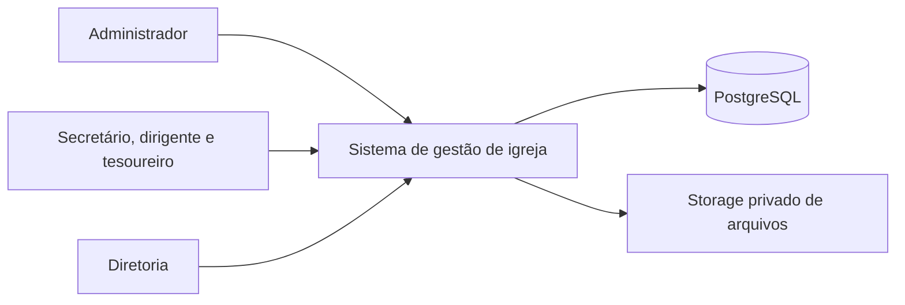
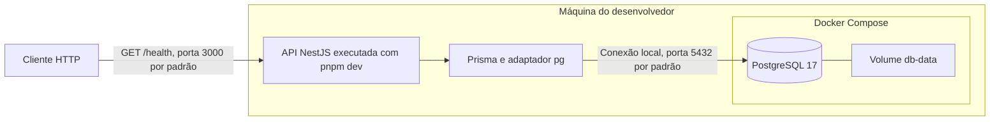
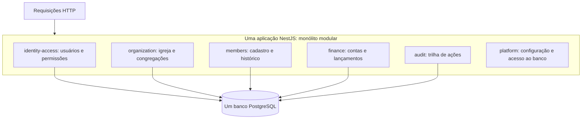
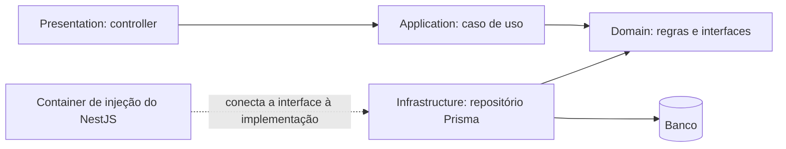
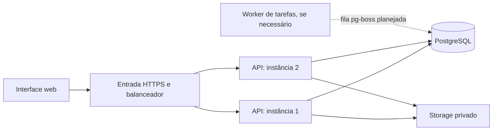

# Arquitetura em desenhos

[Voltar ao guia](README.md)

## 1. Contexto do produto — planejado

Esta visão mostra quem usa o produto e quais sistemas externos participam. A interface web, o storage e os módulos de negócio ainda não existem no código.

O membro é uma pessoa cadastrada; ele não é necessariamente um usuário com login. O portal do membro está fora do MVP.

## 2. Execução local — implementado

A API roda fora do Docker. O volume mantém os dados quando o container é recriado. Isso não substitui backup. O Compose atual é para desenvolvimento, e a hospedagem de produção está adiada no ADR 0007.

## 3. Módulos do backend — planejado

As setas para o banco representam a persistência das tabelas de cada módulo. Ter um banco compartilhado não autoriza um módulo a consultar as tabelas de outro. A colaboração deve acontecer por uma interface pública ou por eventos; ainda não existe uma infraestrutura de eventos implementada.

## 4. Camadas de um módulo — padrão planejado

Aqui as setas sólidas entre camadas indicam **dependências de código**. O caso de uso chama uma interface de repositório; em execução, o Nest fornece sua implementação com Prisma. O domínio permanece independente de HTTP e banco. Veja a [regra de camadas](../arquitetura-do-codigo.md).

## 5. Possível evolução de implantação — proposta

Este desenho é uma hipótese de evolução, não uma decisão de hospedagem. Antes de adotá-lo, medir carga e garantir que sessões, arquivos e tarefas não dependam da memória ou disco de uma única instância. Dimensionar o total de conexões ao banco considerando todas as instâncias e workers. A fila pg-boss é a escolha registrada no ADR 0002, mas ainda não foi implementada.
