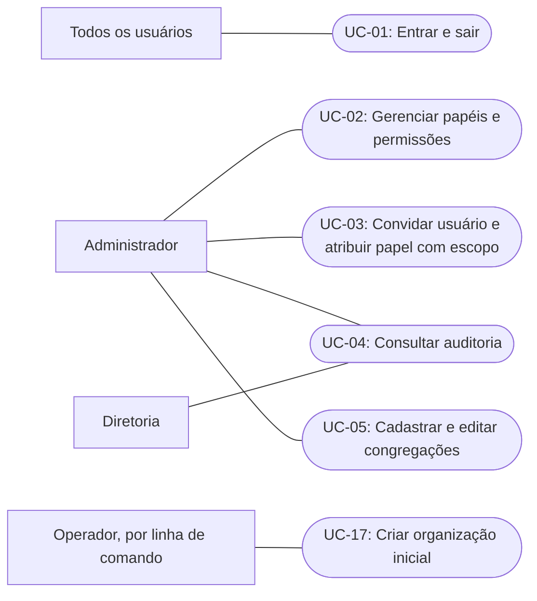
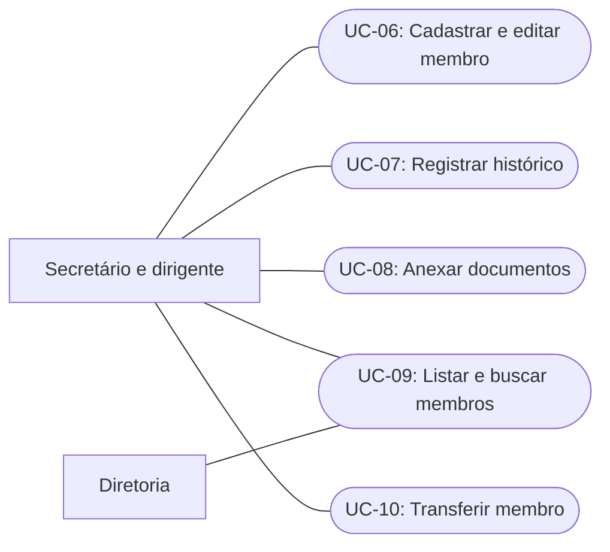
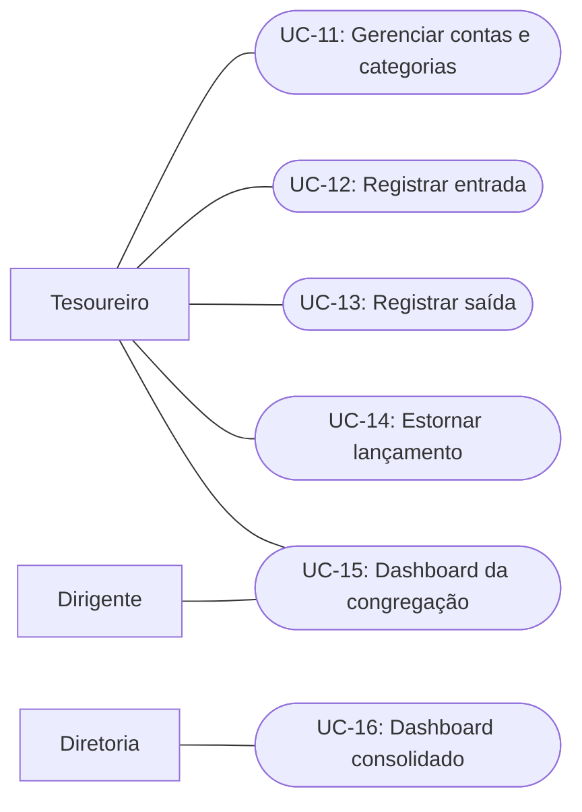

# Casos de uso em desenhos

[Voltar ao guia](README.md)

**Estágio: planejado.** Os IDs correspondem aos [casos de uso do MVP](../casos-de-uso-mvp.md). Usamos fluxogramas Mermaid para representar atores e objetivos; esta é uma visão simplificada, sem a notação completa de UML.

## Administração e acesso

## Membros

## Finanças e visão consolidada

As ligações reproduzem os atores da tabela de requisitos. Não são a matriz definitiva de autorização: os papéis são configuráveis e o acesso depende também da organização e da congregação. O acesso total do dirigente à sua congregação precisa ser conciliado com permissões específicas, sobretudo de leitura de contribuição individual, antes de criar os papéis semente.

## Do requisito ao teste — exemplo proposto para UC-06

| Item             | Definição para revisão                                               |
| ---------------- | -------------------------------------------------------------------- |
| Objetivo         | Cadastrar um membro na congregação autorizada                        |
| Pré-condições    | Usuário autenticado e com permissão de cadastro no escopo solicitado |
| Entrada          | Dados do membro e congregação de destino                             |
| Resultado        | Membro cadastrado na organização do usuário e alteração auditada     |
| Falhas esperadas | Dados inválidos, congregação inexistente ou acesso negado            |

Exemplos de critérios de aceite:

1. Dado um secretário autorizado na congregação A, ao enviar dados válidos para A, o membro é criado em A e a alteração é auditada.
2. Dado o mesmo usuário sem acesso à congregação B, ao tentar cadastrar em B, nenhum membro é criado.
3. Dada uma congregação de outra organização, a operação é rejeitada sem revelar seus dados nem criar registros.
4. Dados que violem o contrato são rejeitados antes de persistir o cadastro.

Os campos obrigatórios, a política de duplicidade e o formato final de erros ainda precisam ser definidos. Os exemplos são uma proposta de especificação, não testes já executados.

## Do requisito ao teste — exemplo proposto para UC-05

| Item             | Definição para revisão                                                                          |
| ---------------- | ----------------------------------------------------------------------------------------------- |
| Objetivo         | Manter as congregações da organização: cadastrar, editar, desativar, reativar e designar a sede |
| Pré-condições    | Administrador autenticado na organização                                                        |
| Resultado        | Congregações consistentes: uma sede ativa e nomes únicos                                        |
| Falhas esperadas | Nome repetido, desativar a sede, sede inativa, conflito de edição simultânea                    |

Exemplos de critérios de aceite (cada um vira um teste; as regras de 1 a 5 são de domínio, sem banco):

1. Ao cadastrar uma congregação com nome válido, ela nasce **ativa e não-sede**, na organização do administrador.
2. Nome já usado na mesma organização, ignorando caixa, acentos e espaços nas pontas (`Sao Paulo` e `  SÃO PAULO `), é rejeitado e nada é criado.
3. O mesmo nome em **outra** organização é aceito.
4. Desativar a sede é rejeitado; depois de designar outra sede, a antiga pode ser desativada.
5. Designar uma nova sede deixa exatamente uma sede: a antiga deixa de ser, a nova passa a ser, e a nova precisa estar ativa.
6. Duas designações simultâneas: uma conclui e a outra recebe conflito (integração, com `version`).
7. Se algo burlar o domínio e tentar gravar duas sedes ou um nome repetido, o banco recusa (integração, índices únicos).
8. O administrador da organização A não enxerga nem altera congregações da B; a consulta devolve "não encontrado", sem revelar que existe.

Os itens 1 a 5 são domínio puro; 6 e 7 exigem PostgreSQL; 8 exige autenticação e entra com a camada HTTP. Decisões em [ADR 0009](../adr/0009-modulo-organization.md).

## Rastreabilidade para implementação

| Casos de uso  | Módulo responsável   | Dados principais                        | Verificação de maior risco                                 |
| ------------- | -------------------- | --------------------------------------- | ---------------------------------------------------------- |
| UC-01 a UC-03 | identity-access      | Usuários, papéis e atribuições          | Autenticação e acesso por escopo                           |
| UC-04         | audit                | Registros de auditoria                  | Acesso restrito e impossibilidade de alteração pela API    |
| UC-05, UC-17  | organization         | Organização e congregações              | Sede única, nome único e isolamento entre organizações     |
| UC-06 a UC-10 | members              | Membros, histórico e documentos         | Escopo, privacidade e transferência consistente            |
| UC-11 a UC-15 | finance              | Contas, categorias e lançamentos        | Valores exatos, estorno único, quem pede não aprova (a sede decide), saldo nunca negativo e ausência de acesso cruzado |
| UC-16         | Composição a definir | Consultas públicas de members e finance | Consolidação limitada à organização autorizada             |

O dashboard consolidado não autoriza acesso direto às tabelas de outros módulos. O desenho de sua composição deve preservar as interfaces públicas dos módulos.
