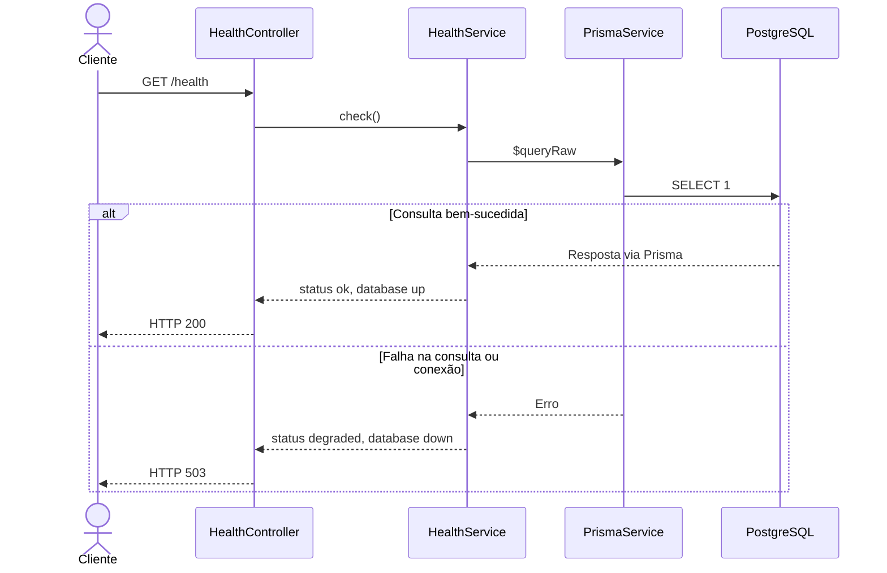
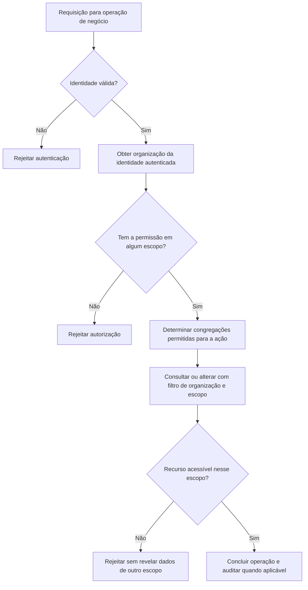
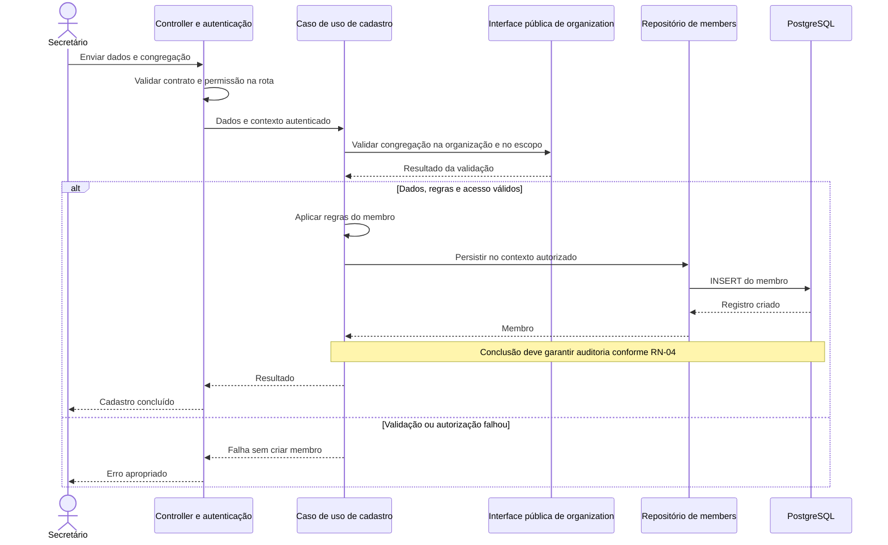
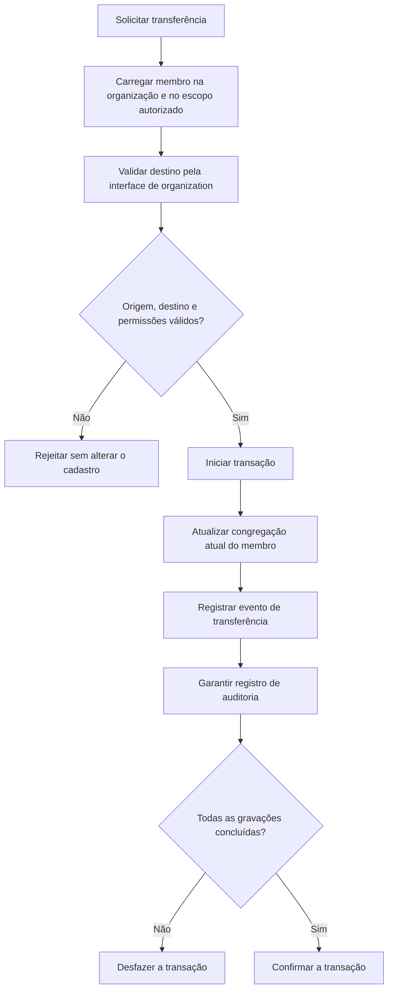
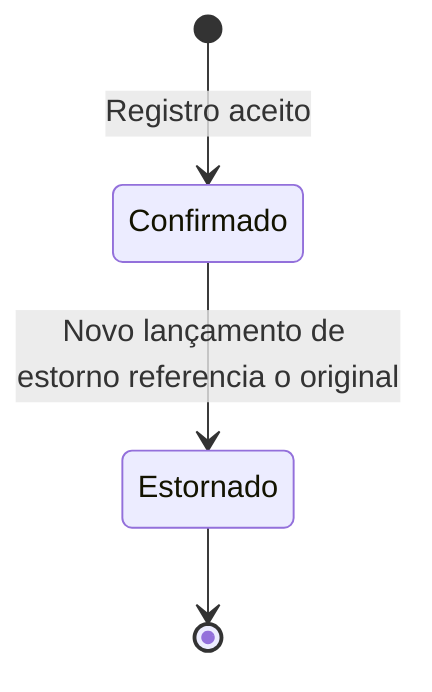
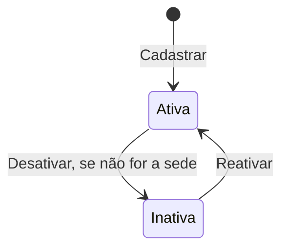
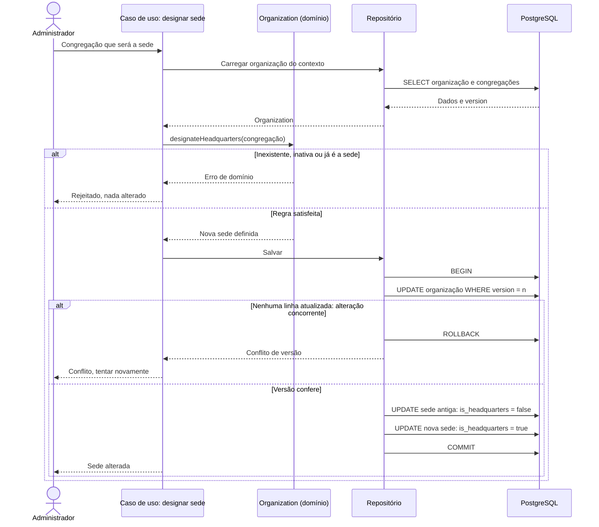
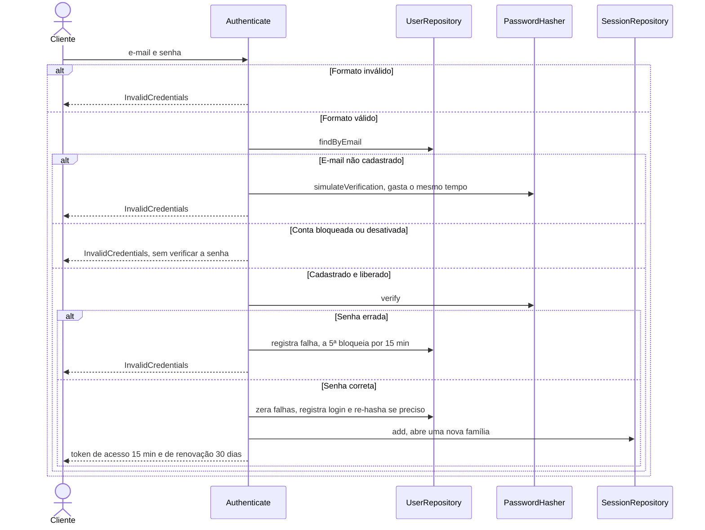
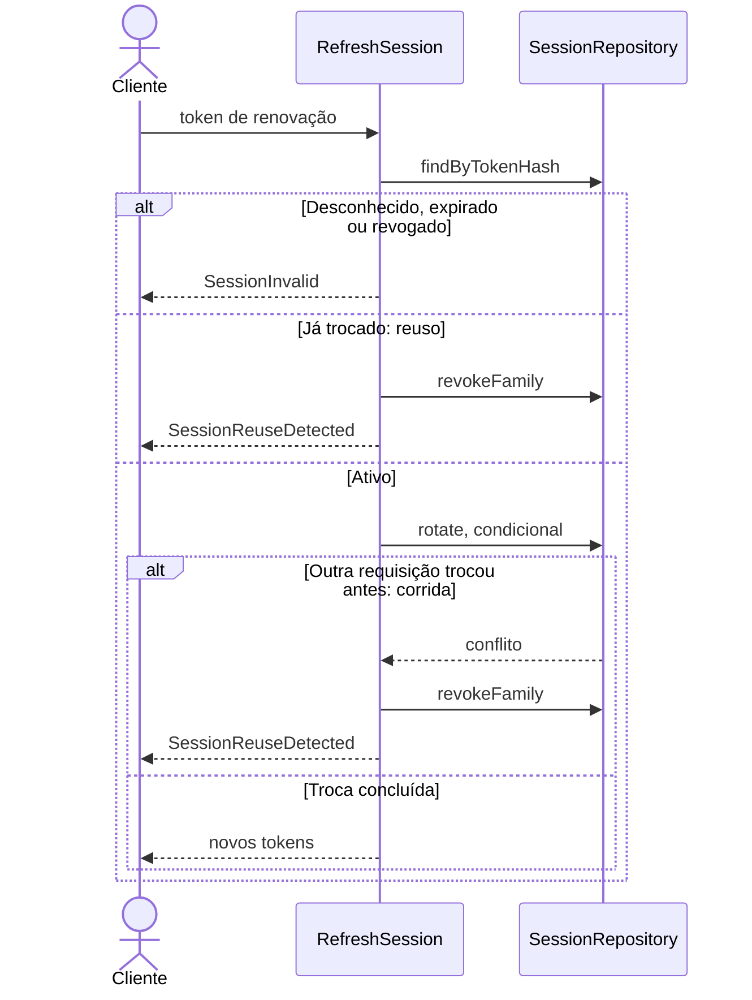
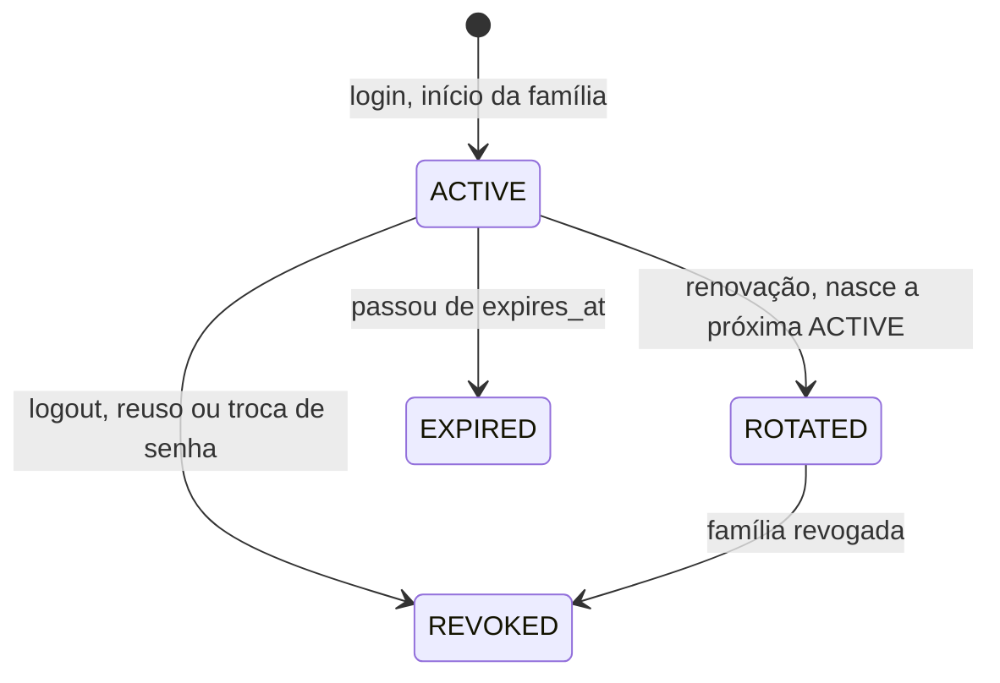

# Fluxos e comportamento

[Voltar ao guia](README.md)

Diagramas de sequência mostram a ordem das mensagens; atividades mostram decisões; estados mostram o ciclo de vida de uma entidade. Apenas o primeiro fluxo abaixo está implementado.

## 1. Verificar saúde da API — implementado

Não exige autenticação. Uma resposta saudável comprova que uma consulta simples ao banco funcionou, não que todos os futuros módulos estão operacionais.

## 2. Autorizar uma operação — planejado

O guard e o filtro de dados cumprem funções diferentes. Ter permissão para cadastrar em uma congregação não libera todas as congregações. A organização vem da identidade autenticada, nunca de um `organization_id` enviado pelo cliente. Os detalhes do contexto autenticado e dos erros ainda serão implementados.

## 3. Cadastrar membro, UC-06 — proposta de sequência

A fronteira com `organization` evita consultar diretamente suas tabelas dentro de `members`. Este fluxo é ilustrativo: nomes finais de classes, tratamento de falhas de persistência e integração com auditoria ainda precisam ser definidos. O modelo de domínio prevê interceptor de auditoria; garantir consistência entre gravação e auditoria exige detalhar a transação antes da implementação.

## 4. Transferir membro, UC-10 — proposta de atividade

A atualização e o histórico precisam ser consistentes: não pode existir transferência sem rastro. Ainda é necessário decidir se um usuário precisa de acesso às duas congregações ou se haverá outro procedimento de autorização. Transferência entre organizações não está definida neste caso de uso.

## 5. Lançamento e estorno, UC-12 a UC-14 — planejado

Este é um **estado lógico**, calculado pela existência de um estorno; não propõe uma coluna de status. O original continua armazenado e imutável. O encerramento no desenho não significa exclusão. Rascunhos, aprovações e estorno de estorno não estão especificados aqui.

Exemplo: uma entrada de R$ 100,00 é armazenada como `10000` centavos com direção `IN`. Seu estorno gera um novo lançamento de `10000` centavos com direção `OUT`, referenciando o original. O efeito líquido no saldo é zero, e os dois registros preservam a história.

Na implementação, validar organização, escopo, unicidade de estorno e vínculo com o original. Duas requisições simultâneas de estorno devem resultar em apenas um estorno persistido.

## 6. Ciclo de vida da congregação, UC-05 — implementado (domínio e aplicação; sem camada HTTP)

Congregação não é excluída: há membros e lançamentos ligados a ela. "Sede" não é um estado, e sim um atributo de uma
congregação **ativa**, e a sede não pode ser desativada. Para desativá-la, designa-se outra sede antes (fluxo abaixo).
Este estado é regra de negócio, visível e reversível; não é o soft delete (`deleted_at`) dos demais cadastros.
Decisão em [ADR 0009](../adr/0009-modulo-organization.md).

## 7. Designar nova sede, UC-05 — implementado (domínio, aplicação e repositório; sem camada HTTP)

Dois pontos que o desenho torna visíveis:

- **A ordem dos `UPDATE`s importa.** O índice único parcial "uma sede por organização" é verificado a cada comando e
  não é adiável. Marcar a nova antes de desmarcar a antiga violaria o índice no meio da transação. O repositório
  Prisma grava em três passos (desmarcar a sede antiga, atualizar as existentes, inserir as novas), e há teste de
  integração que força a pior ordem da lista (nova sede antes da antiga) para provar que o resultado não depende dela.
- **A versão evita sobrescrita silenciosa.** Duas designações simultâneas partem da mesma `version`; só a primeira
  confirma, a outra recebe conflito.

A gravação da auditoria (RN-04) na mesma transação ainda precisa ser detalhada, como no fluxo do UC-06.

## 8. Entrar, UC-01 — implementado (aplicação; sem camada HTTP)

**Toda falha devolve o mesmo erro**, com a mesma mensagem: quem tenta adivinhar não distingue "e-mail inexistente",
"senha errada", "conta bloqueada" ou "dado malformado". Com e-mail inexistente o sistema ainda **gasta o tempo de
uma verificação real**, para a resposta não ser mais rápida e entregar quais e-mails existem. Conta bloqueada ou
desativada não tem a senha verificada (acertar não adiantaria). Um login em duas abas ao mesmo tempo não falha: a
gravação do usuário repete em caso de conflito de versão.

## 9. Renovar a sessão, UC-01 — implementado (aplicação; sem camada HTTP)

A troca no repositório é **condicional** (só vale se a sessão anterior ainda não foi trocada). Sem isso, duas
requisições simultâneas com o mesmo token criariam duas sessões novas e o roubo passaria despercebido. Quem perde a
corrida é tratado como reuso e a **família inteira** é revogada: dono legítimo e ladrão precisam entrar de novo.
Conta *bloqueada por tentativas* não impede renovar (senão errar a senha de propósito derrubaria o dono); conta
*desativada* impede.

## 10. Estados de uma sessão — implementado (domínio)

Precedência quando mais de uma condição vale: `REVOKED` vence `ROTATED`, que vence `EXPIRED`. Assim, depois que a
família é revogada, reapresentar um token antigo não parece "reuso" de novo. O prazo é deslizante (30 dias a partir
de cada renovação) com teto absoluto de 90 dias desde o login.
