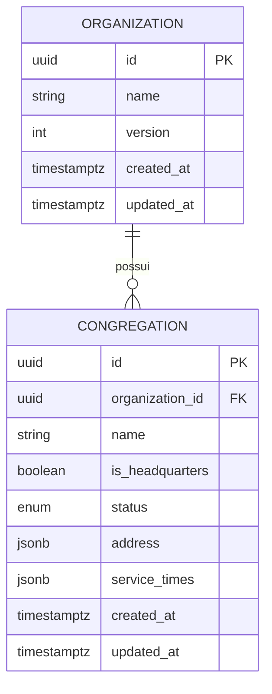
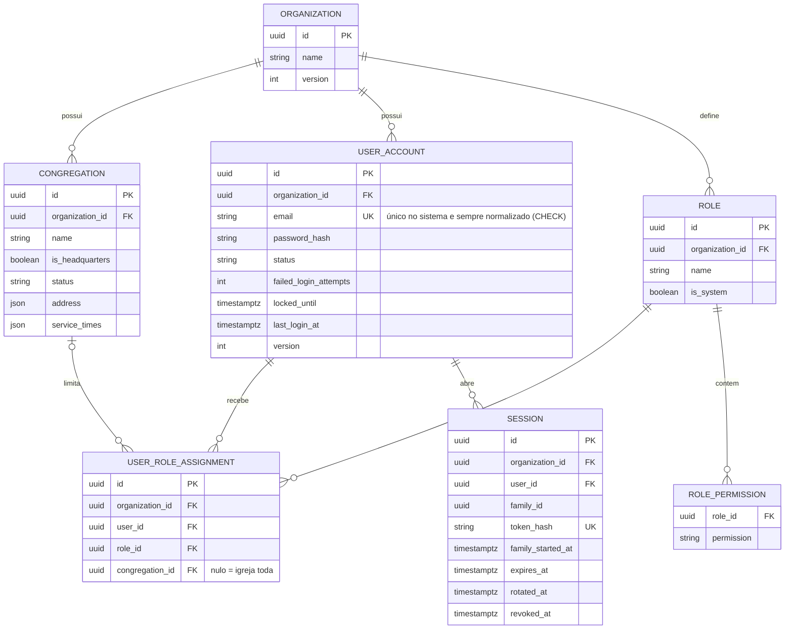
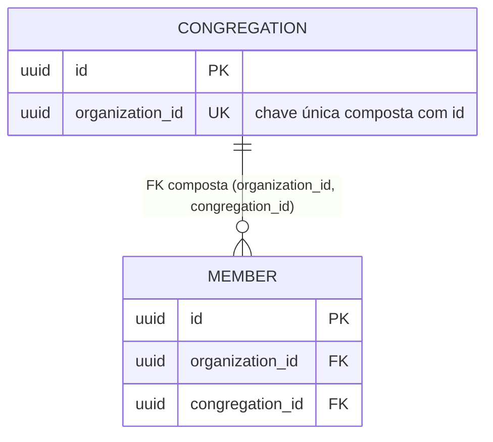
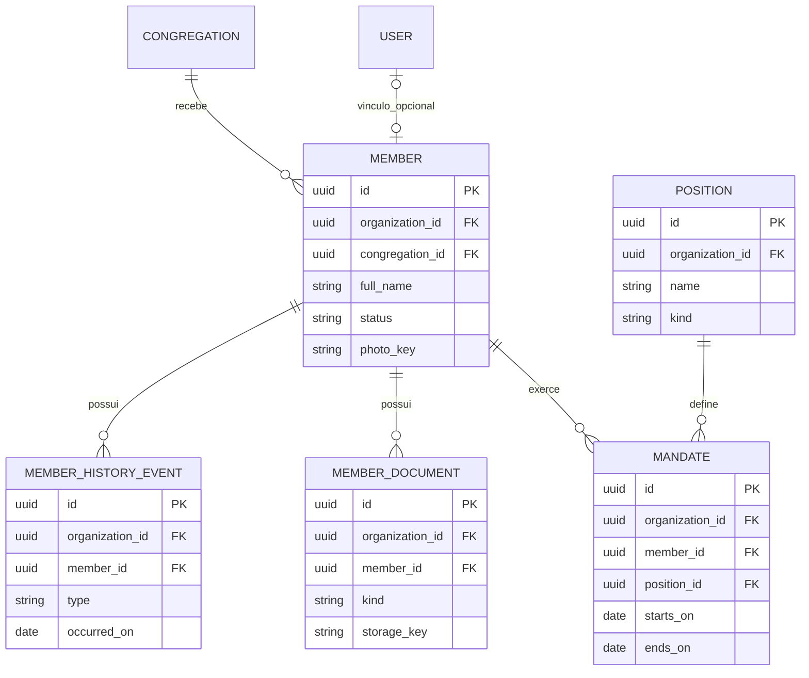
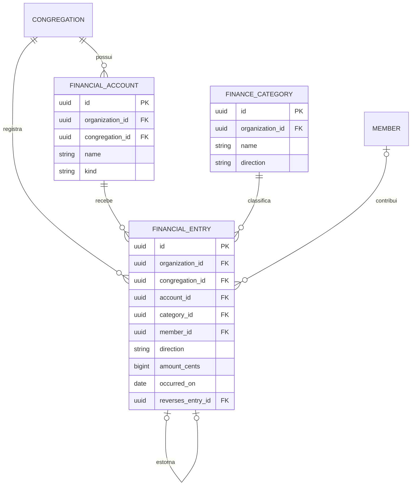
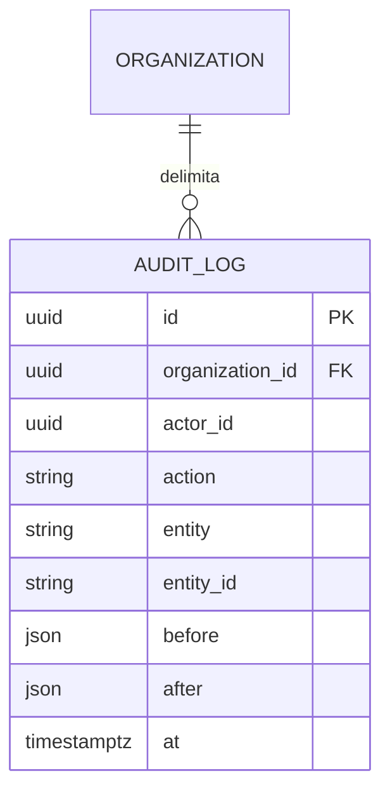

# Modelo entidade-relacionamento em partes

[Voltar ao guia](README.md)

O modelo ER mostra entidades, seus atributos e as quantidades possíveis de relacionamentos. Estes desenhos dividem o [modelo de domínio](../modelo-dominio.md) para facilitar a leitura.

## Como ler

| Símbolo                   | Significado                                  |
| ------------------------- | -------------------------------------------- |
| `\|\|`                    | Exatamente um                                |
| `\|o` (lado esquerdo)     | Zero ou um                                   |
| `o\|` (lado direito)      | Zero ou um                                   |
| `o{` (lado direito)       | Zero ou muitos                               |
| `PK`                      | Chave que identifica o registro              |
| `FK`                      | Referência a outro registro no modelo lógico |

Exemplo: `ORGANIZATION ||--o{ CONGREGATION` lê-se "uma organização possui zero ou muitas congregações; cada congregação pertence a exatamente uma organização".

Os diagramas planejados são um **modelo lógico resumido**, não migrations prontas. `FK` indica a referência desejada; a definição de restrições físicas, nulabilidade e índices deve ser revisada ao implementar. IDs entre módulos não autorizam acesso às tabelas do outro módulo.

## Banco atual — implementado

Estas são as duas tabelas do módulo `organization`, criadas pelas migrations `20261019000000_init` e `20261020120000_organization_congregations`. O ID é UUID v7 **gerado pela aplicação** (sem default no banco). As restrições de `congregation` estão descritas na seção "Integridade da congregação" abaixo e foram exercitadas contra PostgreSQL 17.

As cinco tabelas do `identity-access` (`user_account`, `role`, `role_permission`, `user_role_assignment` e `session`) vieram na migration `20261020150000_identity_access` e estão na seção seguinte. O [schema Prisma](../../apps/api/prisma/schema.prisma) é a fonte da verdade. Os demais módulos (`members`, `finance`, `audit`) ainda não têm tabelas.

## Organização e acesso — implementado (migration `20261020150000`)

**Estágio:** domínio, aplicação e infraestrutura implementados e testados contra PostgreSQL 17 ([ADR 0010](../adr/0010-identity-access-minimo.md)). A tabela de usuários se chama `user_account` porque `user` é palavra reservada no PostgreSQL.

Restrições que o banco impõe (o domínio já garante as mesmas, o banco protege contra qualquer caminho que o contorne):

| Restrição | O que impede | Onde fica |
| --- | --- | --- |
| `UNIQUE (email)` + `CHECK (email = lower(btrim(email)))` | Dois usuários com o mesmo e-mail (em qualquer igreja) e e-mail fora do formato normalizado | Prisma (`@unique`) + SQL manual |
| FK composta `(organization_id, role_id)` → `role` | Dar a um usuário um papel de **outra** igreja | Prisma (relação composta) |
| FK composta `(organization_id, congregation_id)` → `congregation` | Escopo em congregação de outra igreja (nula = igreja toda, e então não é verificada) | Prisma (relação composta) |
| FK composta `(organization_id, user_id)` → `user_account` (atribuições e sessões) | Sessão ou atribuição ligada a usuário de outra igreja | Prisma (relação composta) |
| `UNIQUE (user_id, role_id) WHERE congregation_id IS NULL` e `UNIQUE (user_id, role_id, congregation_id) WHERE congregation_id IS NOT NULL` | A mesma atribuição repetida (duas unicidades parciais, porque `NULL` não se compara em `UNIQUE` comum) | SQL manual |
| `UNIQUE (organization_id, lower(name))` em `role` | Dois papéis com o mesmo nome na igreja | SQL manual |
| `UNIQUE (token_hash)` em `session` | Dois tokens de renovação com o mesmo hash | Prisma (`@unique`) |

Uma atribuição com `congregation_id` nulo vale para a organização inteira. Um usuário pode receber vários papéis em congregações diferentes. O **Administrador** é um papel de sistema (`is_system`) com uma única permissão, `*` ("tudo"), criado por igreja. O token de renovação nunca é gravado: só seu hash (`token_hash`); as sessões de um mesmo login compartilham `family_id`. A sede é uma congregação marcada com `is_headquarters`, não outra entidade.

`status` da congregação é `ACTIVE` ou `INACTIVE`; congregação não é excluída. `version` da organização é o contador do travamento otimista. `address` e `service_times` são JSON validado na aplicação. Os atributos de `organization` e `congregation` seguem o [ADR 0009](../adr/0009-modulo-organization.md); as duas tabelas já existem no banco (ver "Banco atual").

### Integridade da congregação — implementado (migration `20261020120000`)

Restrições da tabela `congregation`, exercitadas por testes de integração em PostgreSQL 17 (ADR 0009). A FK composta ainda não é usada por nenhuma tabela, pois `member` e `financial_entry` não existem. Servem de modelo para os demais módulos:

| Restrição                                  | O que impede                                                         | Onde fica                       |
| ------------------------------------------ | -------------------------------------------------------------------- | ------------------------------- |
| `UNIQUE (organization_id) WHERE is_headquarters` | Duas sedes na mesma organização                                | SQL manual na migration         |
| `UNIQUE (organization_id, lower(name))`    | Mesmo nome com outra caixa na mesma organização                      | SQL manual na migration         |
| `UNIQUE (organization_id, id)`             | Nada por si só; **habilita a FK composta** das outras tabelas        | `@@unique` no `schema.prisma`   |

Uma tabela como `member` referencia a congregação por `(organization_id, congregation_id)`, e o banco rejeita um membro da organização A apontando para uma congregação da organização B, mesmo que o código erre:

Os dois índices manuais não aparecem no `schema.prisma`; quem alterar `congregation` deve preservá-los nas migrations.

## Membros — planejado

O vínculo opcional entre usuário e membro é conceitual: a coluna e a restrição que o implementarão ainda devem ser definidas. Documentos e fotos guardam chaves de storage; o conteúdo dos arquivos fica no storage privado planejado. Os valores finais de status e tipos de histórico aguardam validação com a igreja.

## Finanças — planejado

`member_id` é opcional, permitindo oferta anônima. `reverses_entry_id` é opcional e identifica o lançamento original; cada original pode ter no máximo um estorno. O saldo é calculado pelos lançamentos, sem coluna de saldo neste modelo.

## Auditoria transversal — planejado

`actor_id` identifica quem realizou a ação e `entity`/`entity_id` identificam o objeto afetado. Não há uma FK genérica de `entity_id` para todas as tabelas. O desenho resume o modelo existente; retenção, minimização dos dados registrados e casos sem ator autenticado precisam ser detalhados ao implementar.

## Revisões necessárias antes das migrations

- Garantir que referências não conectem dados de organizações diferentes, usando restrições e validações apropriadas. Para `congregation` o padrão está decidido (FK composta, ADR 0009); aplicar às demais tabelas.
- Definir chaves únicas por organização, inclusive a política de e-mail dos usuários.
- Impedir estornos duplicados também sob concorrência, com restrição de unicidade no banco.
- Garantir coerência entre organização, congregação e conta em um lançamento.
- Definir nulabilidade, índices para consultas reais e regras de exclusão; cadastros seguem o soft delete previsto no modelo de domínio.
- Definir como registrar o autor dos lançamentos conforme ADR 0005; esse atributo ainda não aparece no modelo resumido de domínio.
- Incluir campos comuns de datas e organização nas tabelas apropriadas. A própria `organization` é a raiz e não precisa referenciar a si mesma.
