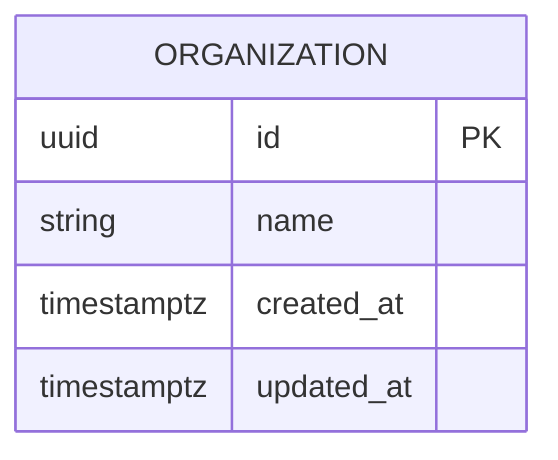
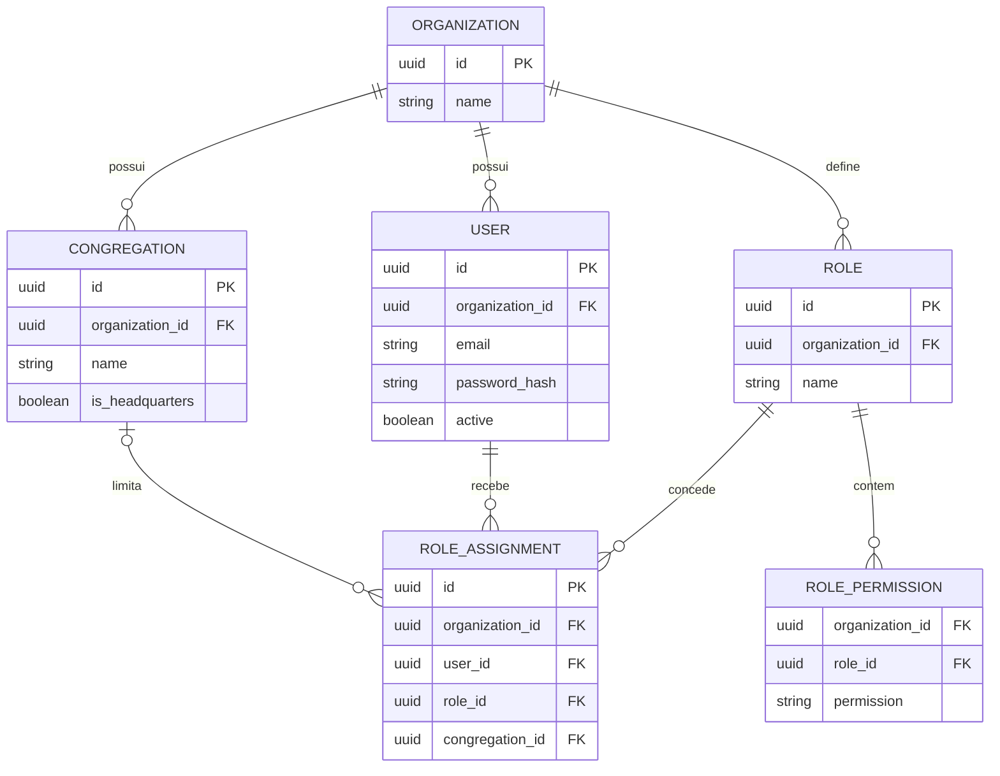
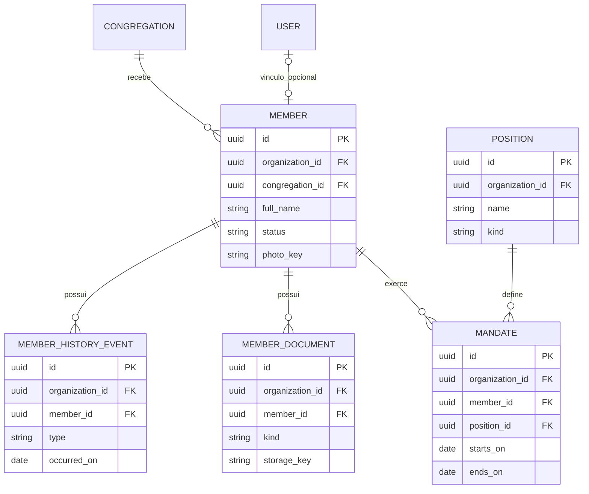
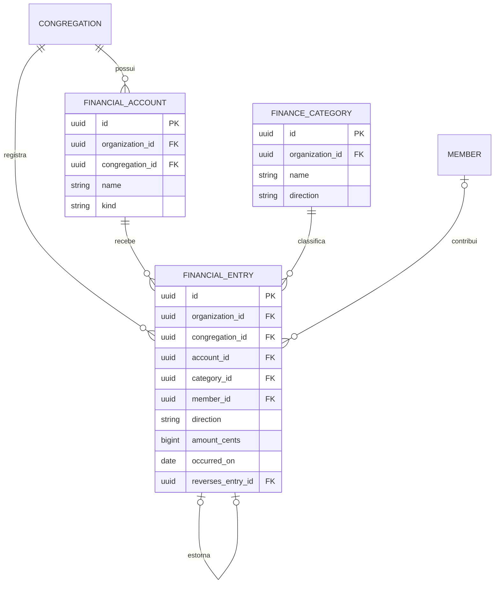
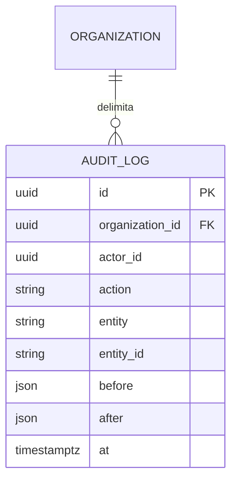

# Modelo entidade-relacionamento em partes

[Voltar ao guia](README.md)

O modelo ER mostra entidades, seus atributos e as quantidades possíveis de relacionamentos. Estes desenhos dividem o [modelo de domínio](../modelo-dominio.md) para facilitar a leitura.

## Como ler

| Símbolo | Significado                                  |
| ------- | -------------------------------------------- | --- | ------------- |
| `       |                                              | `   | Exatamente um |
| `o      | `ou`                                         | o`  | Zero ou um    |
| `o{`    | Zero ou muitos                               |
| `PK`    | Chave que identifica o registro              |
| `FK`    | Referência a outro registro no modelo lógico |

Os diagramas planejados são um **modelo lógico resumido**, não migrations prontas. `FK` indica a referência desejada; a definição de restrições físicas, nulabilidade e índices deve ser revisada ao implementar. IDs entre módulos não autorizam acesso às tabelas do outro módulo.

## Banco atual — implementado

Esta é a única entidade no [schema Prisma atual](../../apps/api/prisma/schema.prisma). O ID é UUID v7. Os modelos abaixo ainda não estão no banco.

## Organização e acesso — planejado

Uma atribuição com `congregation_id` nulo vale para a organização inteira. Um usuário pode receber vários papéis em congregações diferentes. A sede é uma congregação marcada com `is_headquarters`, não outra entidade.

## Membros — planejado

O vínculo opcional entre usuário e membro é conceitual: a coluna e a restrição que o implementarão ainda devem ser definidas. Documentos e fotos guardam chaves de storage; o conteúdo dos arquivos fica no storage privado planejado. Os valores finais de status e tipos de histórico aguardam validação com a igreja.

## Finanças — planejado

`member_id` é opcional, permitindo oferta anônima. `reverses_entry_id` é opcional e identifica o lançamento original; cada original pode ter no máximo um estorno. O saldo é calculado pelos lançamentos, sem coluna de saldo neste modelo.

## Auditoria transversal — planejado

`actor_id` identifica quem realizou a ação e `entity`/`entity_id` identificam o objeto afetado. Não há uma FK genérica de `entity_id` para todas as tabelas. O desenho resume o modelo existente; retenção, minimização dos dados registrados e casos sem ator autenticado precisam ser detalhados ao implementar.

## Revisões necessárias antes das migrations

- Garantir que referências não conectem dados de organizações diferentes, usando restrições e validações apropriadas.
- Definir chaves únicas por organização, inclusive a política de e-mail dos usuários.
- Impedir estornos duplicados também sob concorrência, com restrição de unicidade no banco.
- Garantir coerência entre organização, congregação e conta em um lançamento.
- Definir nulabilidade, índices para consultas reais e regras de exclusão; cadastros seguem o soft delete previsto no modelo de domínio.
- Definir como registrar o autor dos lançamentos conforme ADR 0005; esse atributo ainda não aparece no modelo resumido de domínio.
- Incluir campos comuns de datas e organização nas tabelas apropriadas. A própria `organization` é a raiz e não precisa referenciar a si mesma.
