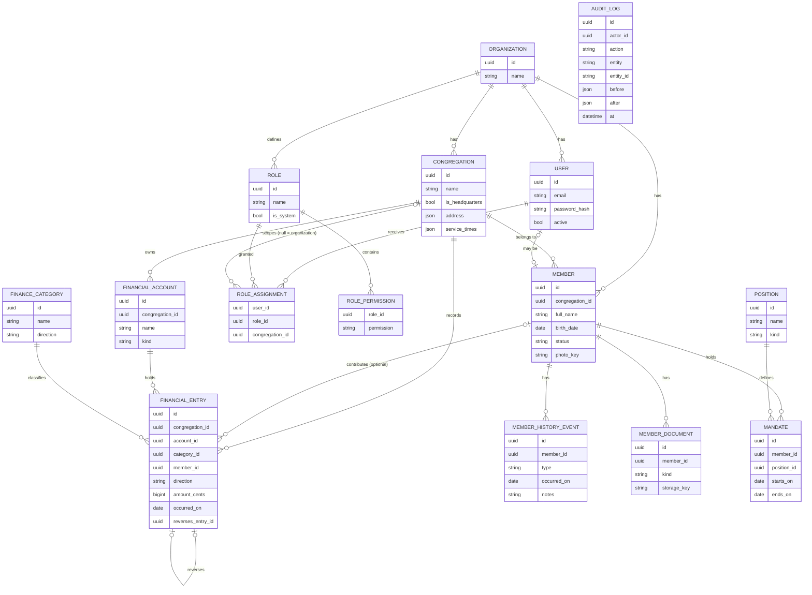

# Modelo de domínio — núcleo do MVP

Convenções (valem para todas as tabelas, exceto onde indicado):

- `id` UUID · `organization_id` (obrigatório, ver ADR 0003) · `created_at` / `updated_at`
- Tabelas de cadastro usam `deleted_at` (soft delete).
- Valores monetários em centavos inteiros (ADR 0005).
- Nomes de tabelas e campos em inglês, conforme o [glossário](glossario.md).

## Decisões de modelagem

1. **Sede é uma `Congregation`** com `is_headquarters = true`. Evita duas entidades para o mesmo conceito.
2. **`ROLE_ASSIGNMENT.congregation_id` nulo = escopo de organização.** É o que permite à Diretoria enxergar tudo (ADR 0004).
3. **`USER` e `MEMBER` são entidades separadas.** Nem todo membro faz login, e um usuário administrativo pode não ser membro. O vínculo é opcional.
4. **`FINANCIAL_ENTRY.direction`** é `IN` ou `OUT`, e **não há `balance` armazenado** (ADR 0005).
5. **`reverses_entry_id`** liga um estorno ao lançamento original. Um lançamento só pode ser estornado uma vez.
6. **`FINANCIAL_ENTRY.member_id` é opcional**, para suportar dízimo identificado e oferta anônima. Quando preenchido, a leitura exige permissão sensível (ADR 0006).
7. **`MEMBER.congregation_id`** guarda a congregação atual; transferências deixam rastro em `MEMBER_HISTORY_EVENT`.
8. **`AUDIT_LOG` não pertence a nenhum módulo de negócio**: é escrito por um interceptor transversal e é somente-anexação.
9. `MEMBER_HISTORY_EVENT.type` e `MEMBER.status` são enumerações; os valores finais dependem da validação com a igreja (ver casos de uso, perguntas 1 a 6).

## Mapeamento módulo → tabelas

| Módulo | Tabelas |
|---|---|
| `identity-access` | `user`, `role`, `role_permission`, `role_assignment` |
| `organization` | `organization`, `congregation` |
| `members` | `member`, `member_history_event`, `member_document`, `position`, `mandate` |
| `finance` | `financial_account`, `finance_category`, `financial_entry` |
| `audit` | `audit_log` |

Cada módulo é dono de suas tabelas. Referências entre módulos (ex.: `financial_entry.member_id`) são apenas
IDs; a consulta de dados do outro módulo passa pela interface pública dele (ADR 0001).
